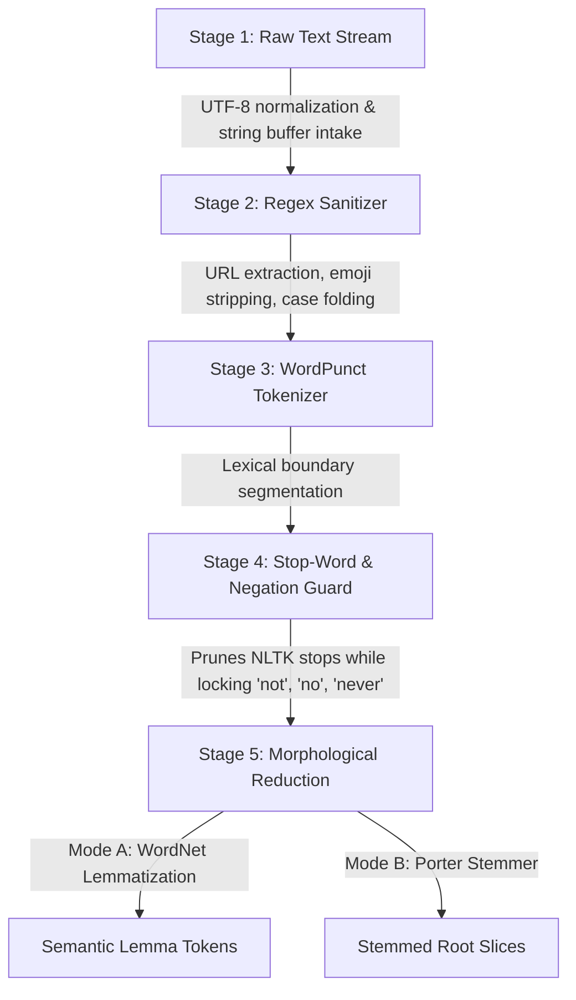

# ⚡ NLP Text Preprocessing Toolkit

[](https://www.python.org/)
[](https://www.nltk.org/)
[](https://streamlit.io/)
[](run_pipeline_tests.py)
[](text_preprocessing_toolkit/syntactic_terminal/DESIGN.md)
[](https://opensource.org/licenses/MIT)

> **High-throughput text sanitization, morphological disambiguation (Porter Stemmer vs. WordNet Lemmatizer), information-theoretic analytics, and interactive developer terminals.**

---

## 📌 Table of Contents

- [Overview](#-overview)
- [Key Features](#-key-features)
- [Architecture & File Structure](#-architecture--file-structure)
- [5-Stage Preprocessing Pipeline](#-5-stage-preprocessing-pipeline)
- [Installation & Quick Start](#-installation--quick-start)
- [Running the Application](#-running-the-application)
  - [1. Unified Terminal Single-Page App (HTML5/Tailwind)](#1-unified-terminal-single-page-app-html5--tailwind)
  - [2. Streamlit Data Science GUI](#2-streamlit-data-science-gui)
  - [3. Standalone Python CLI Pipeline](#3-standalone-python-cli-pipeline)
  - [4. Automated Benchmark Test Suite](#4-automated-benchmark-test-suite)
- [Comparative Dissector: Stemming vs. Lemmatization](#-comparative-dissector-stemming-vs-lemmatization)
- [Analytics & Mathematical Metrics](#-analytics--mathematical-metrics)
- [Benchmark Test Suite & Viva Checklist](#-benchmark-test-suite--viva-checklist)
- [Sample Datasets](#-sample-datasets)
- [Design System & Theme](#-design-system--theme)
- [Academic Defense FAQ](#-academic-defense-faq)
- [License](#-license)

---

## 🌟 Overview

Natural Language Processing (NLP) pipelines rely heavily on clean, normalized text tokens. Unfiltered raw text typically contains URLs, punctuation noise, non-alphanumeric emojis, and domain stopwords that distort downstream models (such as TF-IDF, Word2Vec, BERT, and sentiment classifiers).

However, traditional preprocessing pipelines suffer from two major flaws:
1. **Aggressive Stemming**: Algorithms like Porter Stemmer crudely chop word suffixes, producing non-words (e.g., `studies` $\to$ `studi`) and missing irregular words (e.g., `better` $\to$ `better` instead of root `good`).
2. **Sentiment Distortion**: Standard stopword filters naively eliminate negation tokens (`not`, `no`, `never`, `neither`), completely inverting sentiment analysis predictions.

The **NLP Text Preprocessing Toolkit** solves these challenges by combining:
- **Deterministic Regex Sanitization** with prioritized URL and emoji extraction.
- **Smart Negation Guard** to preserve context words for sentiment integrity.
- **Morphological Dissector** comparing WordNet Lemmatization against Porter Stemming.
- **Real-Time Analytics** measuring Type-Token Ratio (TTR), Shannon Entropy, and Top Term Frequency distributions.
- **Dual UI Interfaces**: A responsive cyber-slate HTML5 Single-Page Web App and a dedicated Python Streamlit application.

---

## 🚀 Key Features

* **🧹 Comprehensive Sanitization**:
  * Strips HTTP/HTTPS/WWW hyperlinks *prior* to punctuation splitting to prevent orphaned query parameters.
  * Sanitizes unicode emojis (`😊`, `🚀`, pictographs) and social markers (`@mentions`, `#hashtags`).
  * Normalizes punctuation, case folding, and collapses consecutive whitespace.

* **🛡️ Smart Negation Guard**:
  * Guards negation tokens (`not`, `no`, `never`, `neither`, `nor`, `cannot`) from stopword deletion, protecting sentiment polarity.

* **🔬 Morphological A/B Matrix**:
  * Side-by-side comparison of **Porter Stemmer** (rule-based suffix slicing) vs. **WordNet Lemmatizer** (Princeton WordNet 3.1 synset relational database with 155,287 lemmas).
  * Validates outputs with dictionary classification badges (`Valid Dict`, `Non-Word`, `Unchanged`).

* **📊 Information-Theoretic Analytics**:
  * **Type-Token Ratio (TTR)**: Real-time lexical diversity computation ($V / N$).
  * **Shannon Entropy**: Measures informational uncertainty in bits.
  * **Hapax Legomena Detection**: Identifies singleton tokens occurring exactly once.
  * **Noise Pruning Audit**: Detailed forensic accounting of pruned characters, links, and matched stopwords.

* **💻 Two Interactive Interfaces**:
  1. **HTML5 Syntactic Terminal Web App**: Pure front-end reactive single-page application with tabbed navigation (Studio, Analytics, Pipeline, Roadmap).
  2. **Streamlit Application**: Native Python GUI with interactive Matplotlib bar charts and custom stopword configuration.

---

## 📂 Architecture & File Structure

```
text-preprocessing-toolkit/
├── index.html                 # Unified single-page web app (Studio, Analytics, Pipeline, Roadmap)
├── app.py                     # Streamlit interactive dashboard
├── preprocessing.py           # Core text preprocessor engine (Regex, NLTK, Negation Guard)
├── analytics.py               # Statistical engine (TTR, Shannon Entropy, Term Frequencies)
├── nlp_pipeline.py            # Standalone demonstration CLI script
├── run_pipeline_tests.py      # Automated benchmark test runner (6/6 tests)
├── requirements.txt           # Pinned Python package dependencies
├── .gitignore                 # Excludes cache, virtual environments, and temporary files
│
├── samples/                   # Curated evaluation datasets
│   ├── medical_abstracts.txt  # Clinical trial texts testing entity & negation retention
│   ├── twitter_sentiments.csv # Social media dataset testing emojis, mentions & sentiment
│   └── legal_contracts.txt    # Formal contracts testing complex phrasing & clauses
│
└── text_preprocessing_toolkit/# High-resolution prototype screen templates
    ├── preprocessing_studio/  # Studio template & screen mockup
    ├── text_analytics_frequency/ # Analytics & frequency distribution template
    ├── advanced_nlp_pipeline/ # Morphology vectorizer template
    ├── project_roadmap_guide/ # 7-day academic sprint tracker template
    └── syntactic_terminal/    # Design system specifications (DESIGN.md)
```

---

## 🔄 5-Stage Preprocessing Pipeline



1. **Stage 1: Raw Text Stream** — String intake, length accounting, and UTF-8 validation.
2. **Stage 2: Regex Sanitizer** — Strips URLs (`https?://\S+`), emojis, and non-word characters; applies lowercase normalization.
3. **Stage 3: WordPunct Tokenizer** — Splits clean strings into lexical tokens along word boundaries.
4. **Stage 4: Stop-Word & Negation Guard** — Removes standard English stopwords while protecting negation terms.
5. **Stage 5: Morphological Reduction** — Dual-mode derivation comparing WordNet Lemmatization with Porter Stemming.

---

## 🛠️ Installation & Quick Start

### Prerequisites
- Python 3.10 or higher
- Git

### 1. Clone the Repository
```bash
git clone https://github.com/Harshithpalan/NLP-mini-project-text-processing-toolkit.git
cd NLP-mini-project-text-processing-toolkit
```

### 2. Create and Activate Virtual Environment
```bash
# Windows
python -m venv venv
.\venv\Scripts\activate

# macOS / Linux
python3 -m venv venv
source venv/bin/activate
```

### 3. Install Dependencies
```bash
pip install -r requirements.txt
```

### 4. Download NLTK Corpora (Handled automatically by the code, or manually):
```bash
python -c "import nltk; nltk.download('stopwords'); nltk.download('wordnet'); nltk.download('omw-1.4')"
```

---

## 🖥️ Running the Application

### 1. Unified Terminal Single-Page App (HTML5 / Tailwind)
Open `index.html` directly in any modern browser, or launch a local web server:

```bash
python -m http.server 8080
```
Navigate to: **`http://localhost:8080/index.html`**

#### Capabilities:
* Live reactive input stream with instant token sequence rendering.
* Configurable pipeline checkboxes (Lowercase, URLs, Punctuation, Emojis, Stopwords, Negation Guard).
* Instant tab switching between **Studio**, **Analytics**, **Pipeline**, and **Roadmap**.
* Clipboard operations (Paste, Copy sanitized output, Export `.txt`).

---

### 2. Streamlit Data Science GUI
Launch the Streamlit interactive dashboard:

```bash
streamlit run app.py
```
Navigate to: **`http://localhost:8501`**

#### Capabilities:
* **Interactive Studio**: Real-time cleaning, noise reduction calculations, and compression metrics.
* **Text Analytics**: Matplotlib horizontal frequency bar charts, TTR, Shannon Entropy, and Hapax Legomena list.
* **NLP Pipeline & Morphology**: Interactive lexeme inspector testing Porter Stemmer vs. WordNet Lemmatizer.
* **Project Roadmap & Viva**: 7-day progress tracker and oral presentation checklist.

---

### 3. Standalone Python CLI Pipeline
Run the demonstration script to inspect pipeline execution in the console:

```bash
python nlp_pipeline.py
```

#### Example Output:
```text
============================================================
TEXT PREPROCESSING PIPELINE EXECUTION
============================================================

[Test Case: Social Tweet]
Raw Input:  Hey!!! I am learning NLP @college 😊, and this is AMAZING!!! Visit https://example.com
Cleaned:    hey i am learning nlp college and this is amazing visit
Lemmatized: ['hey', 'learning', 'nlp', 'amazing', 'visit']
Stemmed:    ['hey', 'learn', 'nlp', 'amaz', 'visit']

[Test Case: Product Review]
Raw Input:  Product was NOT delivered on time! Terrible battery life, but customer support was ok...
Cleaned:    product was not delivered on time terrible battery life but customer support was ok
Lemmatized: ['product', 'not', 'delivered', 'time', 'terrible', 'battery', 'life', 'customer', 'support', 'ok']
Stemmed:    ['product', 'not', 'deliv', 'time', 'terribl', 'batteri', 'life', 'custom', 'support', 'ok']
```

---

### 4. Automated Benchmark Test Suite
Run the 6-point verification test suite:

```bash
python run_pipeline_tests.py
```

```text
============================================================
RUNNING NLP PREPROCESSING TOOLKIT UNIT BENCHMARKS
============================================================
✓ Test 1 Passed: Negations correctly preserved (not, never, neither).
✓ Test 2 Passed: Empty input handled safely without exceptions.
✓ Test 3 Passed: Emojis and unicode symbols sanitized cleanly.
✓ Test 4 Passed: URLs stripped accurately without fragment remnants.
✓ Test 5 Passed: Lemmatization preserves dictionary root 'study'; Stemmer produces 'studi'.
✓ Test 6 Passed: Analytics TTR and Frequency correctly computed.

ALL 6 BENCHMARK TESTS PASSED (100% SUCCESS RATE)
```

---

## ⚖️ Comparative Dissector: Stemming vs. Lemmatization

| Input Token | POS Category | Porter Stemmer Output | WordNet Lemmatizer Output | Linguistic Analysis |
| :--- | :--- | :--- | :--- | :--- |
| **`studies`** | Noun / Verb | `studi` ❌ | `study` ✅ | Porter crudely truncates `-ies` into non-word `studi`. WordNet resolves true base. |
| **`better`** | Adjective | `better` ⚠️ | `good` ✅ | Porter lacks POS context. WordNet cross-references irregular comparative table. |
| **`corpora`** | Noun | `corpora` ⚠️ | `corpus` ✅ | Porter fails on Latin plural inflections. WordNet maps to singular lemma `corpus`. |
| **`learning`**| Verb | `learn` ✅ | `learn` ✅ | Regular suffix `-ing` maps cleanly in both algorithms. |
| **`universities`** | Noun | `univers` ❌ | `university` ✅ | Porter chops to non-word `univers`. Lemmatizer retains valid lexical entry. |

---

## 📐 Analytics & Mathematical Metrics

### 1. Type-Token Ratio (TTR)
Measures the lexical diversity and vocabulary richness of the text:
$$\text{TTR} = \frac{V}{N}$$
Where:
- $V$ = Number of unique word types
- $N$ = Total number of tokens
*A higher TTR indicates greater lexical variation (typical of formal writing), while a lower TTR reflects repetitive vocabulary.*

### 2. Shannon Entropy ($H$)
Quantifies information density and token predictability in bits:
$$H(X) = -\sum_{i=1}^{V} p(x_i) \log_2 p(x_i)$$
Where:
- $p(x_i)$ is the relative frequency probability of token $x_i$.

### 3. Compression & Noise Reduction Ratio
$$\text{Noise Reduction \%} = \frac{C_{\text{raw}} - C_{\text{clean}}}{C_{\text{raw}}} \times 100$$
$$\text{Compression Factor} = \frac{N_{\text{raw}}}{N_{\text{clean}}}$$

---

## 🧪 Benchmark Test Suite & Viva Checklist

The test suite in [`run_pipeline_tests.py`](run_pipeline_tests.py) implements verification across six must-pass test criteria:

- [x] **Test 1: Negation Retention** — Confirms `not`, `no`, `never`, `neither` survive stopword filtering.
- [x] **Test 2: Empty Input Handling** — Zero-length and whitespace-only strings return empty payloads safely without crashing.
- [x] **Test 3: Unicode & Emoji Sanitation** — Eliminates pictographs (`😊`, `🚀`) and `@`/`#` marks cleanly.
- [x] **Test 4: URL Prioritized Ordering** — Extracts hyperlinks prior to punctuation splitting, preventing fragmented strings.
- [x] **Test 5: Stemming vs. Lemmatization** — Asserts dictionary validity for lemmatized roots over stemmer cuts.
- [x] **Test 6: Analytics & TTR** — Verifies mathematical accuracy of Type-Token Ratio and frequency rankings.

---

## 📁 Sample Datasets

The repository includes pre-packaged test vectors in [`samples/`](samples):
1. **`medical_abstracts.txt`**: Clinical diagnostic text evaluating medical terminology retention, URL references, and negation preservation (e.g., *"Treatment was NOT discontinued"*).
2. **`twitter_sentiments.csv`**: Labeled social sentiment corpus with emojis, hashtags, URLs, and contractions.
3. **`legal_contracts.txt`**: Formal contractual agreements with complex punctuation, numbers, and negative liability clauses.

---

## 🎨 Design System & Theme

The user interface follows the **Syntactic Terminal** design system (see [`DESIGN.md`](text_preprocessing_toolkit/syntactic_terminal/DESIGN.md)):
- **Canvas / Surface**: `#0b1326` (Deep Slate)
- **Primary Accent**: `#4cd7f6` / `#06b6d4` (Electric Cyan)
- **Secondary Accent**: `#c0c1ff` / `#6366f1` (Electric Indigo)
- **Validation / Telemetry**: `#4edea3` / `#10b981` (Emerald Telemetry)
- **Error / Deletion**: `#ffb4ab` (Soft Rose)
- **Typography**: **Geist** for interface hierarchy & **JetBrains Mono** for code and metrics.

---

## 🎓 Academic Defense FAQ

### Q1: Why remove URLs *before* removing punctuation?
**Answer:** URLs contain punctuation marks (e.g., `://`, `.`, `?`, `&`, `=`). If punctuation is stripped first, a URL like `https://example.com/test?id=1` gets fragmented into orphaned tokens like `https`, `example`, `com`, `test`, `id`, `1`. Sanitizing URLs via regex first ensures complete removal without noise leakage.

### Q2: Why is the Smart Negation Guard critical for NLP pipelines?
**Answer:** Standard stopword corpora (e.g., NLTK) classify `not`, `no`, `never`, and `nor` as stopwords. If removed, the phrase *"The service was NOT acceptable"* becomes *"service acceptable"*, converting a severe complaint into a false positive sentiment classification.

### Q3: What is the computational trade-off between Porter Stemmer and WordNet Lemmatizer?
**Answer:**
- **Porter Stemmer** is fast ($O(n)$ heuristic character rules) and requires zero lexical database lookups, but produces non-words (`studi`) and lacks grammatical context.
- **WordNet Lemmatizer** performs morphological database lookups on Princeton WordNet 3.1 ($O(n \log m)$ synset search), requiring more memory and computational time, but guarantees valid dictionary headwords and preserves semantic fidelity.

---

## 📄 License

This project is licensed under the **MIT License** — see the [LICENSE](LICENSE) file for details.

Developed with precision for machine learning engineers, computational linguists, and NLP researchers.
